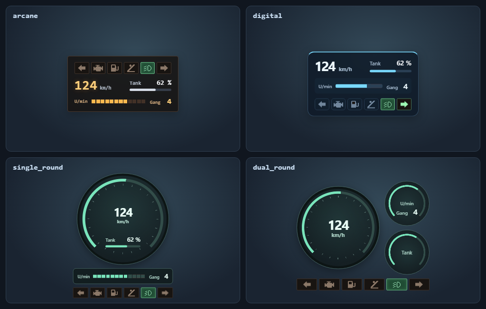
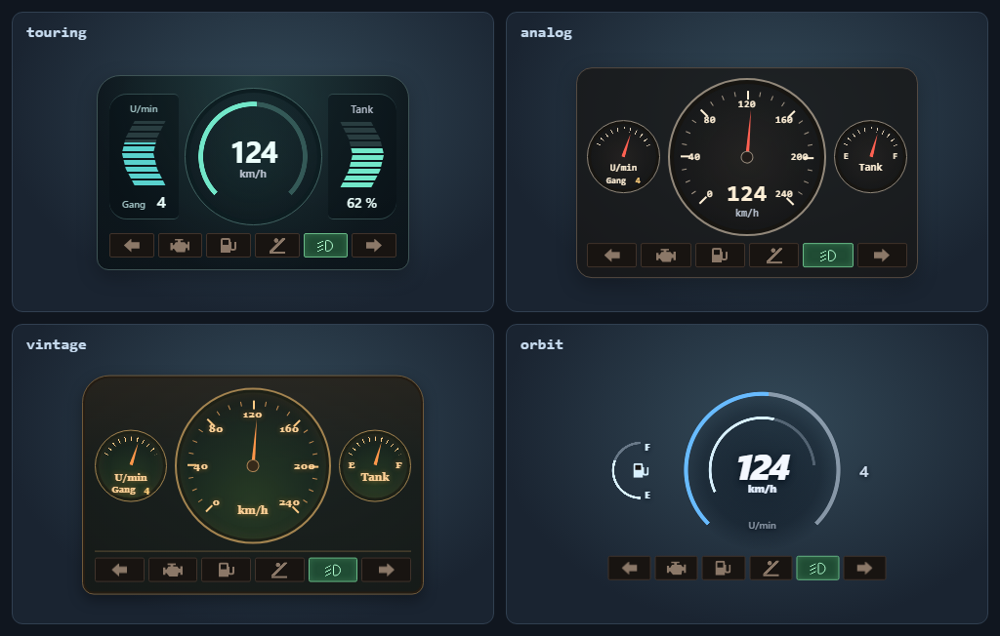

# DaVehicleHUD

Eigenständiges Fahrzeug-HUD für FiveM mit 16 Designs für Autos, Motorräder, Fahrräder und Flugzeuge. Den Tank- oder Akkustand liest der Client über `Config.GetFuel`. Voreingestellt ist `myFuel`.

## Installation

Lege den Ordner `DaVehicleHUD` im Ressourcenverzeichnis ab. Starte deinen Tankanbieter vor DaVehicleHUD. Mit der Standardeinstellung sieht das in der `server.cfg` so aus.

```cfg
ensure myFuel
ensure DaVehicleHUD
```

Wenn du einen anderen Anbieter nutzt, trage dessen Ressourcenname anstelle von `myFuel` ein und passe [den Tankanbieter](#tankanbieter) an.

Mit `setr game_enableFlyThroughWindscreen true` in der `server.cfg` können unangeschnallte Insassen von der FiveM-Spielphysik durch die Windschutzscheibe geschleudert werden. Zusätzlich erkennt DaVehicleHUD harte Kollisionen und löst einen Rauswurf aus, falls die Spielfigur noch im Auto sitzt. Ein angelegter DaVehicleHUD-Gurt schützt vor beiden Effekten.

Falls das eigene HUD von `myFuel` aktiv ist, kannst du es dort mit `Config.EnableUIHUD = false` ausblenden. Falls `esx_cruisecontrol` läuft, deaktiviere dort `Config.Seatbelt.Enable` und `Config.Cruise.Enable`, wenn du Gurt und Tempomat von DaVehicleHUD nutzt.

Nach Änderungen an DaVehicleHUD genügt `restart DaVehicleHUD` in der Serverkonsole.

## Grundeinstellungen

Die Optionen stehen in [config.lua](config.lua).

| Einstellung | Voreinstellung | Funktion |
| --- | --- | --- |
| `Locale` | `'de'` | Sprache für HUD, Gurtmeldungen, Tastenbelegungen und Lichtdiagnose. `'de'` für Deutsch, `'en'` für Englisch. |
| `SpeedUnit` | `'kmh'` | `'kmh'` für km/h oder `'mph'` für Meilen pro Stunde. Geschwindigkeitsringe und analoge Skalen passen sich an. Höhe und Vertikalgeschwindigkeit bleiben in m bzw. m/s. |
| `GetFuel` | `myFuel` | Clientseitige Funktion für Tank- oder Akkustand. Siehe [Tankanbieter](#tankanbieter). |
| `Keybinds` | Siehe [Tasten und Befehle](#tasten-und-befehle) | Standard-Tastenbelegung für Blinker, Warnblinker, Gurt und Tempomat. |
| `IndicatorSoundVolume` | `0.3` | Lautstärke des Blinkerklicks von `0` (stumm) bis `1` (laut). Der Klick läuft nur bei im HUD angezeigten Blinkern. |
| `FuelWarningSoundVolume` | `0.3` | Lautstärke der kurzen Signaltöne bei sichtbarer Tank- oder Akkuwarnung. `0` schaltet den Ton aus. |
| `FuelWarningSoundSeconds` | `5` | Gesamtdauer der Tonfolge in Sekunden. Mit `0` bleibt sie stumm. |
| `FuelWarningIntervalSeconds` | `0.8` | Abstand zwischen zwei Tönen in Sekunden. Kleinster Abstand ist `0.25`. |
| `SeatbeltWarningSeconds` | `30` | Maximale Dauer des Gurtwarntons pro unangeschnallter Phase, in Sekunden. Mit `0` bleibt er stumm. |
| `SeatbeltWarningVolume` | `0.55` | Lautstärke des Gurtwarntons von `0` (stumm) bis `1` (laut). |
| `SeatbeltCrashEjection` | `true` | Zusätzlicher Rauswurf bei einem harten Aufprall ohne Gurt. `false` deaktiviert diese Crash-Erkennung. |
| `SeatbeltCrashMinSpeedKmh` | `80` | Mindesttempo vor dem Aufprall für die zusätzliche Crash-Erkennung. |
| `SeatbeltCrashMinSpeedLossKmh` | `35` | Mindesttempoverlust innerhalb kurzer Zeit bei einer Kollision. Beide Crash-Grenzwerte sind immer in km/h. |
| `CruiseControl.Enabled` | `true` | Aktiviert den Tempomaten für Autos und Motorräder. |
| `Theme` | `'orbit'` | Standarddesign, falls weder Modell, Fahrzeugklasse noch Fahrzeugtyp ein eigenes Design vorgeben. |
| `MotorcycleTheme` | `'motorcycle'` | Standarddesign für Motorräder. Mit `false` gilt `Theme`. |
| `AircraftTheme` | `'aircraft'` | Standarddesign für Flugzeuge und Helikopter. Mit `false` gilt `Theme`. |
| `BicycleTheme` | `'bicycle'` | Standarddesign für Fahrräder. Mit `false` gilt `Theme`. Die Kontrollleuchten bleiben bei Fahrrädern ausgeblendet. |

## Tankanbieter

Ersetze für einen anderen Anbieter die Funktion `Config.GetFuel` in [config.lua](config.lua). Sie bekommt das aktuelle Fahrzeug als FiveM-Entity-Handle und optional das gewählte HUD-Design als zweiten Parameter. Verwende einen **clientseitigen** Export oder eine andere clientseitig verfügbare Datenquelle.

| Rückgabewert | Bedeutung |
| --- | --- |
| Erster Wert | Tank- oder Akkustand in Prozent von `0` bis `100`. Numerische Werte außerhalb des Bereichs werden begrenzt. Gib `nil` zurück, wenn zurzeit kein Wert verfügbar ist. |
| Zweiter Wert, optional | `true` zeigt im Design `electric` die Beschriftung **Akku** an. |
| Dritter Wert, optional | `true` aktiviert die Motorkontrollleuchte wegen eines vom Anbieter gemeldeten Kraftstoffdefekts. |

Beispiel mit dem clientseitigen Export von LegacyFuel. Verwende im Export und in der `server.cfg` den tatsächlichen Ressourcennamen deines Servers. [LegacyFuel-Exporte](https://github.com/InZidiuZ/LegacyFuel#exports)

```lua
Config.GetFuel = function(vehicle)
    if GetResourceState('LegacyFuel') == 'started' then
        return exports['LegacyFuel']:GetFuel(vehicle)
    end
end
```

Für dieses Beispiel startet die `server.cfg` zuerst `ensure LegacyFuel` und dann `ensure DaVehicleHUD`. Wenn der Anbieter keinen Wert liefert oder der Aufruf fehlschlägt, zeigt der Tankwert einen Strich. Die übrigen HUD-Funktionen bleiben verfügbar. Der voreingestellte `myFuel`-Anbieter liefert zusätzlich die Akkubeschriftung und den Status für einen Motorausfall nach Falschbetankung.

## Design nach Fahrzeugklasse

Die Tabelle `Config.VehicleClassThemes` in [config.vehicle.lua](config.vehicle.lua) legt das Standard-HUD für alle 23 GTA-Fahrzeugklassen fest. Zum Beispiel ist Klasse `4` für Muscle Cars auf `analog` eingestellt, Klasse `6` für Sportwagen auf `orbit` und Klasse `7` für Supersportwagen auf `supercar`. Die IDs stehen als Kommentar in der Datei. [FiveM-Fahrzeugklassen](https://github.com/citizenfx/natives/blob/master/VEHICLE/GetVehicleClass.md)

Die Klassen für Motorräder, Fahrräder, Helikopter und Flugzeuge übernehmen standardmäßig die entsprechenden Einstellungen aus `config.lua`. Mit `false` oder einem fehlenden Eintrag wird für die Klasse kein eigenes Design erzwungen. Die Reihenfolge lautet **Modell → Fahrzeugklasse → Fahrzeugtyp → Standarddesign**.

## Ein Design pro Fahrzeug

Für einzelne Ausnahmen steht in [config.vehicle.lua](config.vehicle.lua) links der **Spawnname** und rechts das **Design**. Ein gültiger Eintrag hat Vorrang vor der Fahrzeugklasse. Füge die gewünschten Zeilen zur vorhandenen Tabelle `Config.VehicleThemes` hinzu oder ändere bestehende Einträge.

```lua
adder = 'supercar',
jester = 'orbit',
['mein-addon-auto'] = 'dual_round',
```

Die Datei enthält bereits Zuordnungen für mehrere Serienfahrzeuge. `hydra`, `lazer`, `molotok`, `raiju` und `strikeforce` verwenden `fighter_jet`. Zum Testen kannst du als ESX-Admin beispielsweise `/car adder`, `/car raiju` oder `/car bmx` im Chat eingeben.

## Farben und Transparenz

Alle Designs haben einen eigenen Block in [config.colors.lua](config.colors.lua). Werte sind Hexfarben wie `#68bbff`. Für Transparenz kannst du zwei Stellen für den Alphakanal anhängen, etwa `#10243680` für ungefähr 50 % Deckkraft.

Die Farbwerte werden in dieser Reihenfolge angewendet:

1. Standardfarben des Designs.
2. `round` für `single_round` und `dual_round`.
3. `all` für gemeinsame Anpassungen aller Designs.
4. Der Block des gewählten Designs, etwa `orbit`.

Beispiel für den vorhandenen `orbit`-Block:

```lua
orbit = {
    speed = '#65b7ff',
    rpm = '#ffffff',
    fuel = '#81e6be',
},
```

| Farboption | Funktion |
| --- | --- |
| `accent` | Grundfarbe für Instrumente, sofern keine speziellere Farbe gesetzt ist. |
| `speed`, `rpm`, `fuel` | Farbe der jeweiligen Geschwindigkeits-, Drehzahl- oder Füllstandsanzeige. |
| `redline`, `reserve` | Drehzahlbereich am oberen Ende und Füllstandsanzeige bei Reserve. |
| `needle`, `gear` | Zeigerfarbe und Farbe der Ganganzeige. |
| `text`, `muted` | Haupttext und weniger hervorgehobene Beschriftung. |
| `track`, `ticks`, `border` | Ungefüllte Balken oder Ringe, Skalenstriche und Rahmen. |
| `background`, `backgroundEdge` | Gehäusehintergrund und zweite Farbe eines Hintergrundverlaufs. |
| `dialCenter`, `dialEdge`, `panel` | Zifferblattmitte, Zifferblattrand und Nebenflächen. |

Welche Farboption sichtbar greift, hängt von den Instrumenten des Designs ab. Der Fahrradtacho hat zum Beispiel weder Drehzahl- noch Tankanzeige.

## Tasten und Befehle

| Einstellung in `Config.Keybinds` | Standardtaste | Funktion | F8-Befehl |
| --- | --- | --- | --- |
| `LeftSignal` | **←** (`'LEFT'`) | Linken Blinker umschalten | `davehiclehud_left` |
| `RightSignal` | **→** (`'RIGHT'`) | Rechten Blinker umschalten | `davehiclehud_right` |
| `Hazard` | **↑** (`'UP'`) | Warnblinker umschalten | `davehiclehud_hazard` |
| `Seatbelt` | **B** (`'B'`) | Gurt anlegen oder lösen, auch auf dem Beifahrersitz | `davehiclehud_seatbelt` |
| `CruiseControl` | **Feststelltaste** (`'CAPITAL'`) | Aktuelles Tempo als Solltempo übernehmen oder den Tempomaten ausschalten | `davehiclehud_cruise` |

In [config.lua](config.lua) kannst du die Standardtasten ändern, etwa mit `Seatbelt = 'K'`. Mit `false` wird für den betreffenden Befehl keine Tastenzuordnung registriert. Der F8-Befehl bleibt verfügbar. Bereits gespeicherte persönliche Belegungen kannst du in den **FiveM-Tastenbelegungen** ändern. Die frühere Tempomat-Option `Config.CruiseControl.Key` gilt weiter als Vorgabe, falls `Keybinds.CruiseControl` fehlt.

Mit angelegtem Gurt ist der normale Ausstieg gesperrt. Der Gurt wird bei einem kurzen Resource-Neustart im selben Auto wiederhergestellt und beim Aussteigen oder Löschen des Fahrzeugs zurückgesetzt.

Der Tempomat dosiert das Gas und zeigt bei Aktivierung das Solltempo an. Bei Gefälle kann das Fahrzeug schneller rollen. Bremse, Handbremse, ein starker Crash oder ein Fahrzeugwechsel schalten den Tempomaten aus.

Der Blinkerklick läuft im Takt der HUD-Pfeile. Beim Warnblinker blinken beide Pfeile gemeinsam und teilen sich denselben Klick.

Der Gurtwarnton wiederholt sich bei sichtbarer Gurtwarnung bis zur eingestellten Dauer. Anschnallen beendet den Ton sofort. Beim erneuten Abschnallen beginnt ein neuer Zeitraum.

Der Gurtwarnton `seatbelt-warning.mp3` stammt aus `esx_hud` (`SeatbeltAlertSound.mp3`, Copyright © 2025 ESX-Framework) und ist unter GPL-3.0 oder neuer lizenziert. Die [Lizenz](html/audio/LICENSE-GPL-3.0.txt) liegt beim Sample.

**H** schaltet standardmäßig die Fahrzeugscheinwerfer. **G** fährt das Fahrwerk eines Flugzeugs mit einziehbarem Fahrwerk ein oder aus. **E** schaltet bei GTA-Einsatzfahrzeugen standardmäßig die Sirene. Diese Belegungen kommen aus den GTA-Steuerungseinstellungen.

Der F8-Befehl `davehiclehud_lightdebug` protokolliert 12 Sekunden lang die Lichtzustände des aktuellen Fahrzeugs. Mit `davehiclehud_lightdebug night` wird während des Tests zusätzlich die lokale Spielzeit vorübergehend auf 23:00 Uhr gesetzt.

## Die 16 Designs

Die Vorschauen zeigen die HUD-Oberfläche mit simulierten Fahrzeugwerten vor einem neutralen Testhintergrund.

### Arcade und Rundinstrumente



| Design | Merkmale | Beispiel |
| --- | --- | --- |
| `arcane` | Bernsteinfarbene Ziffern und segmentierter Drehzahlbalken | Futo (`futo`) |
| `digital` | Flaches, blau-graues Display mit durchgehender Drehzahlleiste | Streifenwagen (`police`) |
| `single_round` | Ein großer Rundtacho mit Tank im Zifferblatt | Banshee (`banshee`) |
| `dual_round` | Großer Rundtacho und zwei kleine Rundinstrumente für Drehzahl und Tank | Comet (`comet2`) |

### Sportwagen und Elektrofahrzeuge


| Design | Merkmale | Beispiel |
| --- | --- | --- |
| `supercar` | Kantiges Display mit gelbem Drehzahlbalken | Adder (`adder`) |
| `supercar2` | Breiter Drehzahlbogen mit zentraler Gangzahl | Zentorno (`zentorno`) |
| `supercar3` | Runder Drehzahlmesser mit rotem Zeiger und cyanfarbenem Ring | Tempesta (`tempesta`) |
| `electric` | Flaches Display mit vertikaler Drehzahl- und Akku- oder Tankanzeige | Raiden (`raiden`) |

### Tourenwagen und Klassiker



| Design | Merkmale | Beispiel |
| --- | --- | --- |
| `touring` | Tacho in der Mitte, Drehzahl links und Tank rechts | Dilettante (`dilettante`) |
| `analog` | Drei Zeigerinstrumente für Tempo, Drehzahl und Tank | Sultan (`sultan`) |
| `vintage` | Grüne Zifferblätter mit orangefarbenen Skalen und Zeigern | Tornado (`tornado`) |
| `orbit` | Transparente Geschwindigkeits- und Drehzahlringe mit E/F-Tankanzeige | Jester (`jester`), über die Sportwagenklasse |

### Zweiräder und Flugzeuge


| Design | Merkmale | Beispiel |
| --- | --- | --- |
| `motorcycle` | Kompaktes Display mit Tempo, Drehzahl, Gang und Tank | Bati 801 (`bati`) |
| `aircraft` | Tempo, Höhe über Grund, Vertikalgeschwindigkeit, Kurs und Fahrwerkstatus | Dodo (`dodo`) |
| `fighter_jet` | Flugwerte im grünen Cockpitstil | F-160 Raiju (`raiju`) |
| `bicycle` | LCD-Fahrradtacho mit Tempo und ohne Kontrollleuchten | BMX (`bmx`) |

### Kontrollleuchten

Die Fahrzeug-HUDs zeigen Blinker, Scheinwerfer, Gurtwarnung und je nach Fahrzeug eine Sirenenanzeige. Die Reservewarnung greift unter **15 %**. Beim Aufleuchten startet einmal eine Folge kurzer Pieptöne. Nach dem Auffüllen auf mindestens 15 % ist die Tonfolge für die nächste Reservewarnung wieder aktiv. Die Motorwarnung reagiert auf Motorschaden und auf einen vom Tankanbieter gemeldeten Kraftstoffdefekt. Bei Flugzeugen erscheint die Leuchtenreihe nur bei aktiver Tank- oder Motorwarnung.
