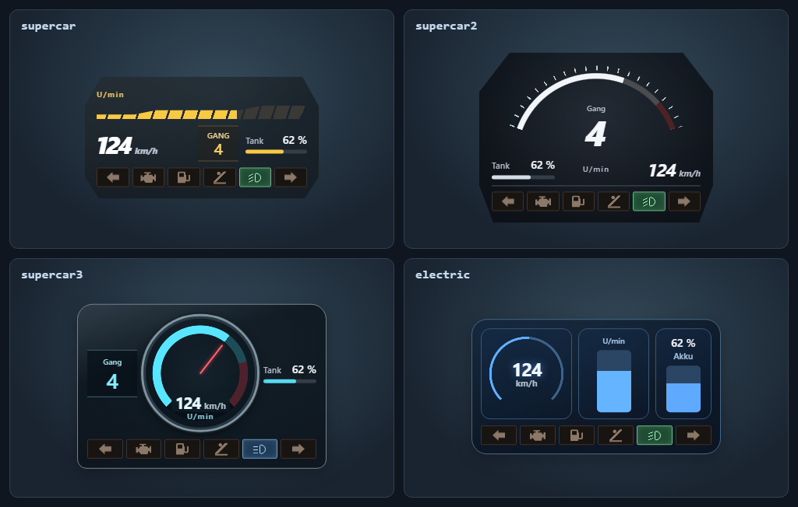
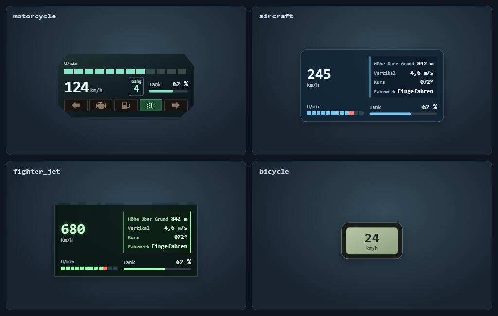

# DaVehicleHUD

Standalone vehicle HUD for FiveM with 16 designs for cars, motorcycles, bicycles, and aircraft. The client reads the fuel level or battery charge through `Config.GetFuel`. The default provider is `myFuel`.

## Installation

Place the `DaVehicleHUD` folder in your resources directory. Start your fuel provider before DaVehicleHUD. For the default setup, add the following to `server.cfg`.

```cfg
ensure myFuel
ensure DaVehicleHUD
```

If you use another provider, replace `myFuel` with its resource name and update the [fuel provider](#fuel-provider) configuration.

Set `setr game_enableFlyThroughWindscreen true` in `server.cfg` to enable FiveM's built-in windscreen ejection for unbuckled occupants. DaVehicleHUD also detects hard collisions and ejects unbuckled occupants if they are still in the car. Fastening the DaVehicleHUD seat belt prevents both effects.

If the built-in `myFuel` HUD is active, you can hide it by setting `Config.EnableUIHUD = false` in its configuration. If `esx_cruisecontrol` is running, disable its `Config.Seatbelt.Enable` and `Config.Cruise.Enable` settings when using DaVehicleHUD's seat belt and cruise control.

After making changes, run `restart DaVehicleHUD` in the server console.

## General settings

The options below are in [config.lua](config.lua).

| Setting | Default | Description |
| --- | --- | --- |
| `Locale` | `'de'` | Language for the HUD, seat belt messages, key bindings, and headlight diagnostics. Use `'de'` for German or `'en'` for English. |
| `SpeedUnit` | `'kmh'` | Use `'kmh'` for km/h or `'mph'` for miles per hour. Speed rings and analog scales adjust to the selected unit. Altitude and vertical speed still use m and m/s. |
| `GetFuel` | `myFuel` | Client-side function that returns the fuel level or battery charge. See [Fuel provider](#fuel-provider). |
| `Keybinds` | See [Key bindings and commands](#key-bindings-and-commands) | Default keys for the turn signals, hazard lights, seat belt, and cruise control. |
| `IndicatorSoundVolume` | `0.3` | Turn signal click volume from `0` (muted) to `1` (full volume). It plays only when the turn signals are shown in the HUD. |
| `FuelWarningSoundVolume` | `0.3` | Volume of the short beeps while the low fuel or low battery warning is visible. Set to `0` to mute them. |
| `FuelWarningSoundSeconds` | `5` | Total duration of the beep sequence, in seconds. Set to `0` to mute it. |
| `FuelWarningIntervalSeconds` | `0.8` | Time between beeps, in seconds. The minimum is `0.25`. |
| `SeatbeltWarningSeconds` | `30` | Maximum duration of the warning sound each time you are unbuckled, in seconds. Set to `0` to mute it. |
| `SeatbeltWarningVolume` | `0.55` | Seat belt warning volume from `0` (muted) to `1` (full volume). |
| `SeatbeltCrashEjection` | `true` | Adds scripted ejection for unbuckled occupants in hard collisions. Set to `false` to disable this crash detection. |
| `SeatbeltCrashMinSpeedKmh` | `80` | Minimum speed before impact for scripted ejection. |
| `SeatbeltCrashMinSpeedLossKmh` | `35` | Minimum speed lost in a short time during a collision. Both crash thresholds are always in km/h. |
| `CruiseControl.Enabled` | `true` | Enables cruise control for cars and motorcycles. |
| `Theme` | `'orbit'` | Fallback theme when no model, vehicle class, or vehicle type sets one. |
| `MotorcycleTheme` | `'motorcycle'` | Default theme for motorcycles. Set to `false` to fall back to `Theme`. |
| `AircraftTheme` | `'aircraft'` | Default theme for airplanes and helicopters. Set to `false` to fall back to `Theme`. |
| `BicycleTheme` | `'bicycle'` | Default theme for bicycles. Set to `false` to fall back to `Theme`. Warning lamps stay hidden on bicycles. |

## Fuel provider

To use a different provider, replace `Config.GetFuel` in [config.lua](config.lua). It receives the current vehicle as a FiveM entity handle. The second argument is the selected HUD theme, which your function can ignore if it does not need it. Use a **client-side** export or another data source available on the client.

| Return value | Description |
| --- | --- |
| First value | Fuel level or battery charge as a percentage from `0` to `100`. Values outside that range are clamped. Return `nil` when a reading is unavailable. |
| Second value, optional | Return `true` to show **Battery** in the `electric` theme. |
| Third value, optional | Return `true` to turn on the check-engine lamp when the provider reports a fuel system fault. |

This example uses the LegacyFuel client export. Use the actual resource name from your server in both the export call and `server.cfg`. [LegacyFuel exports](https://github.com/InZidiuZ/LegacyFuel#exports)

```lua
Config.GetFuel = function(vehicle)
    if GetResourceState('LegacyFuel') == 'started' then
        return exports['LegacyFuel']:GetFuel(vehicle)
    end
end
```

For this example, run `ensure LegacyFuel` before `ensure DaVehicleHUD` in `server.cfg`. If the provider returns no value or the call fails, the fuel readout shows a dash. The rest of the HUD remains available. The default `myFuel` provider also supplies the battery label and reports engine failures caused by putting the wrong fuel in the vehicle.

## Themes by vehicle class

The `Config.VehicleClassThemes` table in [config.vehicle.lua](config.vehicle.lua) sets a default HUD for all 23 GTA vehicle classes. For example, class `4` (muscle cars) uses `analog`, class `6` (sports cars) uses `orbit`, and class `7` (supercars) uses `supercar`. The class names are listed in the comments. [FiveM vehicle classes](https://github.com/citizenfx/natives/blob/master/VEHICLE/GetVehicleClass.md)

The motorcycle, bicycle, helicopter, and airplane classes use the corresponding values from `config.lua` by default. Set a class entry to `false` or omit it to skip that class override. The selection order is **model → vehicle class → vehicle type → fallback theme**.

## Themes by vehicle model

For individual overrides in [config.vehicle.lua](config.vehicle.lua), use the **spawn name** as the key and the **theme** as the value. A valid model entry takes precedence over the vehicle class. Add or edit entries inside the existing `Config.VehicleThemes` table.

```lua
adder = 'supercar',
jester = 'orbit',
['mein-addon-auto'] = 'dual_round',
```

The file already includes assignments for several stock vehicles. The `hydra`, `lazer`, `molotok`, `raiju`, and `strikeforce` use `fighter_jet`. As an ESX admin, you can use `/car adder`, `/car raiju`, or `/car bmx` in chat to test them.

## Colors and transparency

Each design has its own block in [config.colors.lua](config.colors.lua). Use hex colors such as `#68bbff`. To control transparency, append two digits for the alpha channel. For example, `#10243680` is approximately 50% opaque.

Colors are applied in the following order, with later entries taking precedence.

1. The theme's built-in defaults.
2. The `round` block for `single_round` and `dual_round`.
3. The `all` block for settings shared across all themes.
4. The selected theme's block, such as `orbit`.

Here is an example for the existing `orbit` block.

```lua
orbit = {
    speed = '#65b7ff',
    rpm = '#ffffff',
    fuel = '#81e6be',
},
```

| Color option | Description |
| --- | --- |
| `accent` | Base instrument color when a more specific color is unavailable. |
| `speed`, `rpm`, `fuel` | Speed, engine speed, and fuel or battery gauge colors. |
| `redline`, `reserve` | Upper RPM range and low fuel or low battery indicator colors. |
| `needle`, `gear` | Gauge needle and gear display colors. |
| `text`, `muted` | Primary text and secondary label colors. |
| `track`, `ticks`, `border` | Unfilled bars or rings, scale marks, and borders. |
| `background`, `backgroundEdge` | Housing background and gradient edge color. |
| `dialCenter`, `dialEdge`, `panel` | Dial center, dial edge, and secondary panels. |

The available color options depend on the instruments in the selected theme. The bicycle HUD, for example, has only a speed display.

## Key bindings and commands

| Setting in `Config.Keybinds` | Default key | Action | F8 command |
| --- | --- | --- | --- |
| `LeftSignal` | **←** (`'LEFT'`) | Toggle the left turn signal | `davehiclehud_left` |
| `RightSignal` | **→** (`'RIGHT'`) | Toggle the right turn signal | `davehiclehud_right` |
| `Hazard` | **↑** (`'UP'`) | Toggle the hazard lights | `davehiclehud_hazard` |
| `Seatbelt` | **B** (`'B'`) | Fasten or unfasten the seat belt, including in a passenger seat | `davehiclehud_seatbelt` |
| `CruiseControl` | **Caps Lock** (`'CAPITAL'`) | Set cruise control to the current speed or switch it off | `davehiclehud_cruise` |

Change the default keys in [config.lua](config.lua), for example with `Seatbelt = 'K'`. Set an entry to `false` to skip registering its key binding. The F8 command remains available. Change any previously saved personal bindings in **FiveM's key binding settings**. The former `Config.CruiseControl.Key` option still supplies the default when `Keybinds.CruiseControl` is absent.

Fastening the seat belt blocks the normal vehicle exit. The seat belt state is restored after a brief resource restart if you stay in the same car. It resets when you leave the car or the car is deleted.

Cruise control adjusts the throttle and shows the target speed when you activate it. The vehicle can coast above the target downhill. Applying the brake or handbrake, a hard crash, or switching vehicles cancels cruise control.

The turn signal click follows the HUD arrows. With the hazard lights on, both arrows flash together and share one click.

The seat belt warning repeats while its lamp is visible, up to the configured duration. Fastening the belt stops the sound immediately. Unfastening it starts a new warning period.

The `seatbelt-warning.mp3` sample comes from `esx_hud` (`SeatbeltAlertSound.mp3`, Copyright © 2025 ESX-Framework) and is licensed under GPL-3.0 or later. The [license](html/audio/LICENSE-GPL-3.0.txt) is included with the sample.

By default, **H** toggles vehicle headlights, **G** raises or lowers retractable landing gear, and **E** toggles the siren in GTA emergency vehicles. You can change these keys in GTA's control settings.

The F8 command `davehiclehud_lightdebug` logs the current vehicle's light states for 12 seconds. Use `davehiclehud_lightdebug night` to temporarily set your local in-game time to 23:00 during the test.

## The 16 designs

The previews show the HUD with simulated vehicle data against a neutral test background. The screenshots use German HUD labels.

### Arcade and round gauges


| Design | Features | Example |
| --- | --- | --- |
| `arcane` | Amber digits and a segmented RPM bar | Futo (`futo`) |
| `digital` | Flat blue-gray display with a continuous RPM bar | Police Cruiser (`police`) |
| `single_round` | One large round speedometer with a fuel gauge inside the dial | Banshee (`banshee`) |
| `dual_round` | Large round speedometer with two smaller dials for RPM and fuel | Comet (`comet2`) |

### Sports cars and electric vehicles



| Design | Features | Example |
| --- | --- | --- |
| `supercar` | Angular display with a yellow RPM bar | Adder (`adder`) |
| `supercar2` | Wide RPM arc with a central gear display | Zentorno (`zentorno`) |
| `supercar3` | Round tachometer with a red needle and a cyan ring | Tempesta (`tempesta`) |
| `electric` | Flat display with vertical RPM and battery or fuel bars | Raiden (`raiden`) |

### Touring and classic designs


| Design | Features | Example |
| --- | --- | --- |
| `touring` | Speedometer in the center, RPM on the left, and fuel on the right | Dilettante (`dilettante`) |
| `analog` | Three traditional needles for speed, RPM, and fuel | Sultan (`sultan`) |
| `vintage` | Green dials with orange-lit scales and needles | Tornado (`tornado`) |
| `orbit` | Transparent speed and RPM rings with an E/F fuel gauge | Jester (`jester`), through the sports car class |

### Two-wheelers and aircraft



| Design | Features | Example |
| --- | --- | --- |
| `motorcycle` | Compact speed, RPM, gear, and fuel display | Bati 801 (`bati`) |
| `aircraft` | Speed, height above ground, vertical speed, heading, and landing gear status | Dodo (`dodo`) |
| `fighter_jet` | Flight data in a green cockpit-style display | F-160 Raiju (`raiju`) |
| `bicycle` | LCD-style speedometer with no warning lamps | BMX (`bmx`) |

### Indicator and warning lamps

Vehicle HUDs show turn signals, headlight status, a seat belt warning, and a siren indicator where applicable. The low fuel or low battery warning comes on below **15%** and starts one sequence of short beeps. Refilling or recharging to at least 15% resets the sound for the next warning. The check-engine lamp reacts to engine damage and fuel system faults reported by the fuel provider. On aircraft, the warning row appears only when a fuel or engine warning is active.

## 💬 Support

Need help, found a bug, or have a question?

Join our Discord server for support!

[](https://discord.gg/Cxfe2y8TJ)
